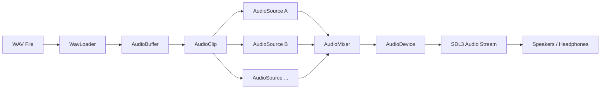
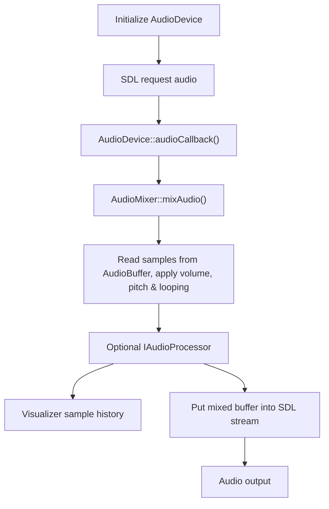

# C++ Audio Engine

> **Work in Progress**

A small audio engine in C++.

The project focuses on understanding how audio playback works below: loading WAV files, storing PCM samples, managing audio resources, mixing multiple audio sources, handling playback state, pitch and looping, and sending the final audio stream to an output device through SDL3.

## Features

- WAV file loader
- PCM audio conversion to floating-point samples
- Support for:
  - PCM 8-bit
  - PCM 16-bit
  - PCM 24-bit
  - PCM 32-bit
  - IEEE Float WAV
  - WAVE_FORMAT_EXTENSIBLE
- Audio clips and resource management
- Multiple simultaneous audio sources
- Play / Pause / Stop / Restart
- Pitch controlled playback
- Linear interpolation between samples
- Looping playback
- Mono to stereo channel mapping
- Real time audio mixing
- Configurable audio asset directories
- Block-based DSP processor hook
- Master low-pass and high-pass filters
- Three-band master EQ controls
- Atomic sample history for audio visualizers
- Output clipping protection
- SDL3 audio device and stream handling
- Unit tests using GoogleTest
- CMake-based build system

## Technologies

- C++20
- SDL3
- CMake
- GoogleTest
- Dear ImGui
- Visual Studio

## Architecture

The engine separates audio file parsing, audio data, playback state, mixing and hardware output into independent components.



### Main Components

```text
WavLoader
    Parses RIFF/WAVE files and converts samples to float PCM.

AudioBuffer
    Stores decoded interleaved PCM sample data.

AudioClip
    Represents an audio asset and references an AudioBuffer.

ResourceManager
    Loads audio assets and manages AudioBuffers and AudioClips.

AudioSource
    Stores playback state and controls an individual sound instance.

AudioMixer
    Mixes all active AudioSources, runs the configured DSP processor, and publishes output samples.

AudioDevice
    Connects the mixer with the SDL3 audio playback system.
```

## Audio Callback flow



## Resource paths, DSP and visualization

Asset locations are selected with `AudioResourceConfig` and passed into `AudioEngine`:

```cpp
AudioResourceConfig resources;
resources.rootPath = "Assets";
resources.sourceDirectory = "SoundSrc";
resources.clipDirectory = "AudioClips";
resources.createDirectoriesOnInit = true;

AudioEngine engine({}, resources);
engine.loadAudioAssets();
```

Paths are relative to the process working directory unless `rootPath` is absolute. The source WAVs are scanned under `rootPath / sourceDirectory`; clip metadata is scanned and saved under `rootPath / clipDirectory`.

An `IAudioProcessor` receives one interleaved float block after source mixing and before final clipping. It runs on the audio callback thread, so its implementation must not allocate, block, or throw. Build an `AudioProcessorChain` on a control thread, add effects in processing order, then submit it with `AudioMixer::setMasterProcessorChain()`. The chain is sealed when submitted, and the change takes effect at the start of an audio block. Passing `nullptr` bypasses master DSP. After switching chains, call `AudioMixer::collectRetiredProcessorChains()` from a control thread to release chains the callback has finished using; `AudioEngine` also collects them during its normal source management calls.

The current chain is a master stage: it processes the complete mix once. It supports up to 16 processors, in insertion order, and changing the chain is queued through a bounded command queue. A full queue makes `setMasterProcessorChain()` return `false`; retry later from the control thread.

The editor's `DSP Effects` panel can enable a low-pass filter, a high-pass filter, and a three-band EQ. The filters are first-order per-channel filters; the EQ separates low, mid, and high bands with complementary one-pole crossovers. Filter cutoff and EQ gain changes are smoothed over time. Each effect supports up to 16 channels.

The `Audio Visualizer` panel shows the latest output waveform, peak and RMS levels, and a logarithmic FFT spectrum calculated on the UI thread. Its EQ response graph shows the three-band EQ transfer curve. Drag a band handle vertically to change its gain or horizontally to change the crossover placement; the graph and the DSP sliders stay synchronized.

`AudioMixer::copyVisualizationSamples()` copies the newest samples in chronological order into caller-owned memory. Samples are interleaved by channel and reflect the final, clipped output. `AudioMixer::getFormat()` gives the channel count and sample rate; the UI can copy samples during its regular update and calculate waveform or spectrum data outside the audio callback.

## Building

Requirements:

- C++20 compatible compiler
- CMake 3.20+
- SDL3
- GoogleTest

Example:

```bash
cmake -S . -B build
cmake --build build
```

Run the application from the build directory.

Tests can be executed with:

```bash
ctest --test-dir build
```

## Tests

The project uses GoogleTest for unit testing.

Tests cover components such as:

- AudioBuffer
- AudioClip
- AudioMixer
- WavLoader
- ResourceManager

## Project Status

The project is currently **work in progress**.

This is an educational audio engine rather than a production-ready audio library.

### Planned Improvements

- UI via DearImGui
- Audio buses
- Low-pass and high-pass filters
- Simple EQ
- Sample rate conversion
- Runtime audio visualization
